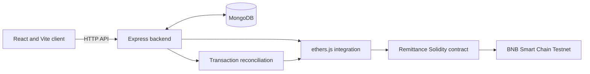

# Remittance System

Full-stack remittance application combining a React interface, an Express API, MongoDB persistence, and Solidity smart contracts. The codebase covers wallet-linked transfers, transaction tracking, and administration. Blockchain configuration targets **BNB Smart Chain Testnet**; this repository is not presented as a live financial service.

**Stack:** React 19 · Vite · Tailwind CSS · Node.js · Express · MongoDB / Mongoose · Solidity · Hardhat · ethers.js

## Application screenshots

These screenshots are stored in the repository (they are not mockups or a hosted demo).

| Interface capture | Interface capture |
| --- | --- |
|  |  |
|  |  |

## What the code implements

- **Account and wallet flows:** registration, login, wallet verification, profile and settings pages.
- **Money movement:** send/request interfaces, transfer links, escrow-based claims, and transaction history.
- **Transaction consistency:** asynchronous reconciliation between API records and on-chain transaction status.
- **Contacts and messaging:** friends, chat flows, and notifications.
- **Administration:** protected admin routes, audit logs, and monitoring pages.

Implementation references: [frontend routes](frontend/src/App.jsx) · [API routes](backend/src/routes/index.js) · [smart contract](contracts/contracts/Remittance.sol) · [reconciliation](backend/src/blockchain/transactionReconciliation.js) · [backend tests](backend/test/)

## Architecture



The frontend handles user-facing flows. Express exposes authenticated API routes and persists records in MongoDB. The blockchain integration uses contract artifacts in [`blockchain/`](blockchain/); reconciliation code tracks transactions after submission. The diagram shows the intended component relationships, not a claim of production deployment.

## Run locally

**Requirements:** Node.js 22.x, npm 10+, a reachable MongoDB instance, and an EVM-compatible wallet for wallet-related workflows.

1. Prepare backend settings. Copy the [root environment example](.env.example) to `backend/.env` and set at least a valid `MONGODB_URI` and a strong `JWT_SECRET`. Optional wallet and on-chain operations require the applicable encryption keys, RPC URL, and contract configuration. Never commit secrets.

2. Run the backend:

   ```bash
   cd backend
   npm ci
   npm run dev
   ```

3. In another terminal, start the frontend. You can create `frontend/.env` with `VITE_API_URL=http://localhost:5000` if you need to specify the API origin:

   ```bash
   cd frontend
   npm ci
   npm run dev
   ```

4. Open **http://localhost:5173**. The backend health endpoint is **http://localhost:5000/api/health**.

### Docker

With `backend/.env` configured and MongoDB reachable **from the container**, run:

```bash
docker compose up --build
```

The Compose configuration exposes the frontend on port `5173` and the backend on `5000`. A host-only database URL such as `127.0.0.1` may need adjustment for container networking.

### Smart contracts (testnet)

```bash
cd contracts
npm ci
npx hardhat compile
npx hardhat test
```

For testnet deployment, configure `BSC_TESTNET_RPC_URL` and `BSC_TESTNET_PRIVATE_KEY` according to the [contracts README](contracts/README.md), then use the deployment script documented there. Review the contract release checklist before publishing artifacts. Do not use real funds for experimentation.

## Tests and project references

| Area | Command or reference |
| --- | --- |
| Backend tests | `cd backend && npm test` |
| Frontend tests | `cd frontend && npm test` |
| End-to-end tests | `cd frontend && npm run test:e2e` |
| Smart contract tests | `cd contracts && npx hardhat test` |
| Frontend documentation | [frontend/README.md](frontend/README.md) |
| Smart contract documentation | [contracts/README.md](contracts/README.md) |
| Threat model | [docs/threat-model.md](docs/threat-model.md) |
| Security review | [docs/security-review.md](docs/security-review.md) |
| Test matrix | [docs/security-test-matrix.md](docs/security-test-matrix.md) |
| Requirements evidence | [docs/srs-system-requirements-evidence.md](docs/srs-system-requirements-evidence.md) |

Tests and security documentation describe the repository's implementation and verification work; they are not proof that the system has been audited or deployed to production.

## Repository layout

```text
frontend/      React UI, tests, and e2e tests
backend/       Express API, MongoDB models, and background reconciliation
contracts/     Solidity source, Hardhat tests, and deployment scripts
blockchain/    Shared contract ABI and deployment metadata
docs/          Requirements, security, and operational documents
screenshots/   Application screenshots
```
